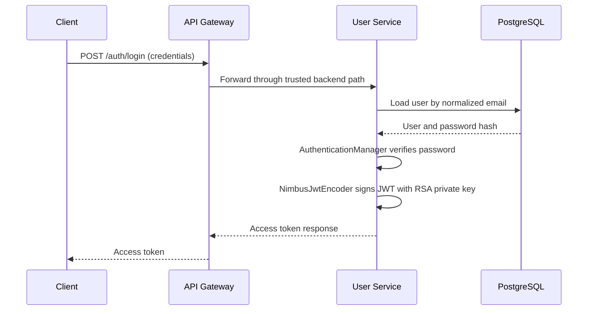

<div align="center">

# 🔐 ChessTracker User Service

### Identity, account lifecycle, and RSA-signed access tokens.

[](https://openjdk.org/)
[](https://spring.io/projects/spring-boot)
[](https://spring.io/projects/spring-security)
[](https://www.postgresql.org/)

[← ChessTracker](https://github.com/illia-krupko/chess-tracker) · [API Gateway](https://github.com/illia-krupko/chess-tracker-api-gateway) · [Infrastructure](https://github.com/illia-krupko/chess-tracker-infrastructure)

</div>

---

## 🎯 Responsibility

User Service owns account and authentication behaviour in ChessTracker. It registers users, verifies credentials, manages the authenticated user's profile and account lifecycle, and issues signed access JWTs. Other services do not need access to a user's password or private signing key.

## ✨ Core capabilities

- **Registration:** validate the request, normalize the email, encode the password, and store the account.
- **Login:** authenticate through Spring Security's `AuthenticationManager` and `DaoAuthenticationProvider`, backed by a JPA `UserDetailsService`.
- **Access JWT issuance:** create token claims and sign them with the RSA private key using Spring Security JOSE / `NimbusJwtEncoder`.
- **Profile operations:** retrieve and update the authenticated user's profile.
- **Account security:** change passwords and handle account deletion through the current soft-delete model.
- **Trusted internal access:** validate the shared Gateway trust header and construct request-local authentication from the propagated user identity.
- **Database migrations:** use Liquibase to manage schema changes.
- **API documentation:** expose API metadata through Springdoc OpenAPI.

## 🔄 Authentication flow



For authenticated requests, the Gateway validates the token with the RSA public key, derives the user ID from the token subject, and forwards it to internal services in `X-User-Id`. User Service trusts the propagated identity only after the internal Gateway trust check passes.

## 🔐 JWT design

- `private.pem` is used by User Service to sign tokens.
- `public.pem` is used by token consumers such as the Gateway to verify signatures.
- The user's database ID is carried in the `sub` claim.
- `iat` and `exp` record issue time and expiry.
- Token lifetime is configured through `JWT_EXPIRATION`.

Private signing keys and real credentials must remain outside version control. Access-token validity and resource authorization are separate checks: a valid token must not, by itself, grant access to another user's resources.

## 🛠️ Technology stack

- Java 21 · Spring Boot 4.1.1
- Spring Security · Spring Security JOSE
- Spring Data JPA / Hibernate
- PostgreSQL · Liquibase
- RSA keys · `NimbusJwtEncoder`
- MapStruct · Lombok
- Springdoc OpenAPI
- JUnit · Spring Boot test support · Testcontainers
- Actuator · OpenTelemetry support

## ⚙️ Configuration

The service reads an optional local `.env` file and supports these settings in `application.yaml`:

| Variable / setting | Purpose |
|---|---|
| `SPRING_DATASOURCE_URL` | JDBC URL; default `jdbc:postgresql://localhost:5432/user_service_db` |
| `POSTGRES_USER` | Database username; local default `postgres` |
| `POSTGRES_PASSWORD` | Database password; local default `postgres` |
| `SHARED_GATEWAY_SECRET` | Shared value used to validate the trusted Gateway path |
| `JWT_EXPIRATION` | Access-token lifetime |
| `keys/private.pem` | RSA signing key; store and manage securely |
| `keys/public.pem` | RSA public key for token verification |

The service uses port `8081` and context path `/api` by default. The Gateway's host destination defaults to `localhost:8083`; align the route URI and port mapping for your launch setup. Local database credentials are not production-safe.

## 🚀 Run locally

### Prerequisites

- JDK 21
- PostgreSQL from [ChessTracker Infrastructure](https://github.com/illia-krupko/chess-tracker-infrastructure)
- RSA key pair at the configured classpath locations
- `SHARED_GATEWAY_SECRET` configured consistently with the Gateway
- `JWT_EXPIRATION` set to the required access-token lifetime

From this repository root:

```bash
./gradlew clean build
./gradlew bootRun
```

API documentation is configured at `/api/v3/api-docs`, with Swagger UI at `/api/swagger-ui` relative to the service host and port.

## 🔒 Security principles

- Passwords are stored as encoded hashes, never plaintext.
- User identity is request-scoped and comes from the trusted internal path; it is not a server-side session.
- Public login and registration endpoints still belong behind the Gateway trust boundary.
- The Gateway receives the RSA public key, not the private signing key.

## 🔗 Related repositories

[ChessTracker](https://github.com/illia-krupko/chess-tracker) · [Game Service](https://github.com/illia-krupko/chess-tracker-game-service) · [API Gateway](https://github.com/illia-krupko/chess-tracker-api-gateway) · [Infrastructure](https://github.com/illia-krupko/chess-tracker-infrastructure)
